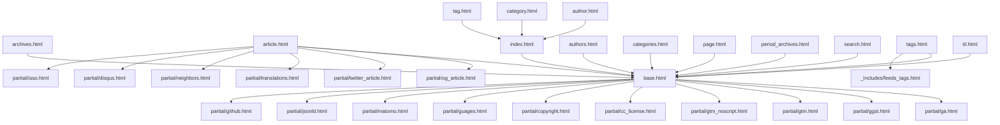

Okay, I will generate a Mermaid diagram of the template hierarchy and dependencies.

Based on the previous analysis, I have the following template inheritance information:

*   `archives.html` extends `base.html`
*   `article.html` extends `base.html`
*   `author.html` extends `index.html`
*   `authors.html` extends `base.html`
*   `category.html` extends `index.html`
*   `categories.html` extends `base.html`
*   `index.html` extends `base.html`
*   `page.html` extends `base.html`
*   `period_archives.html` extends `base.html`
*   `search.html` extends `base.html`
*   `tag.html` extends `index.html`
*   `tags.html` extends `base.html`
*   `til.html` extends `base.html`

I also know that `base.html` includes the following partial templates:

*   `partial/ga.html`
*   `partial/ggst.html`
*   `partial/gtm.html`
*   `partial/gtm_noscript.html`
*   `partial/cc_license.html`
*   `partial/copyright.html`
*   `partial/guages.html`
*   `partial/matomo.html`
*   `partial/jsonld.html`
*   `partial/github.html`

`article.html` includes the following partial templates:

*   `partial/og_article.html`
*   `partial/twitter_article.html`
*   `partial/translations.html`
*   `partial/neighbors.html`
*   `partial/disqus.html`
*   `partial/isso.html`

`tags.html` includes the following partial templates:

*   `_includes/feeds_tags.html`

Here's the Mermaid diagram:



Now I will attempt completion again with the Mermaid diagram.

```xml